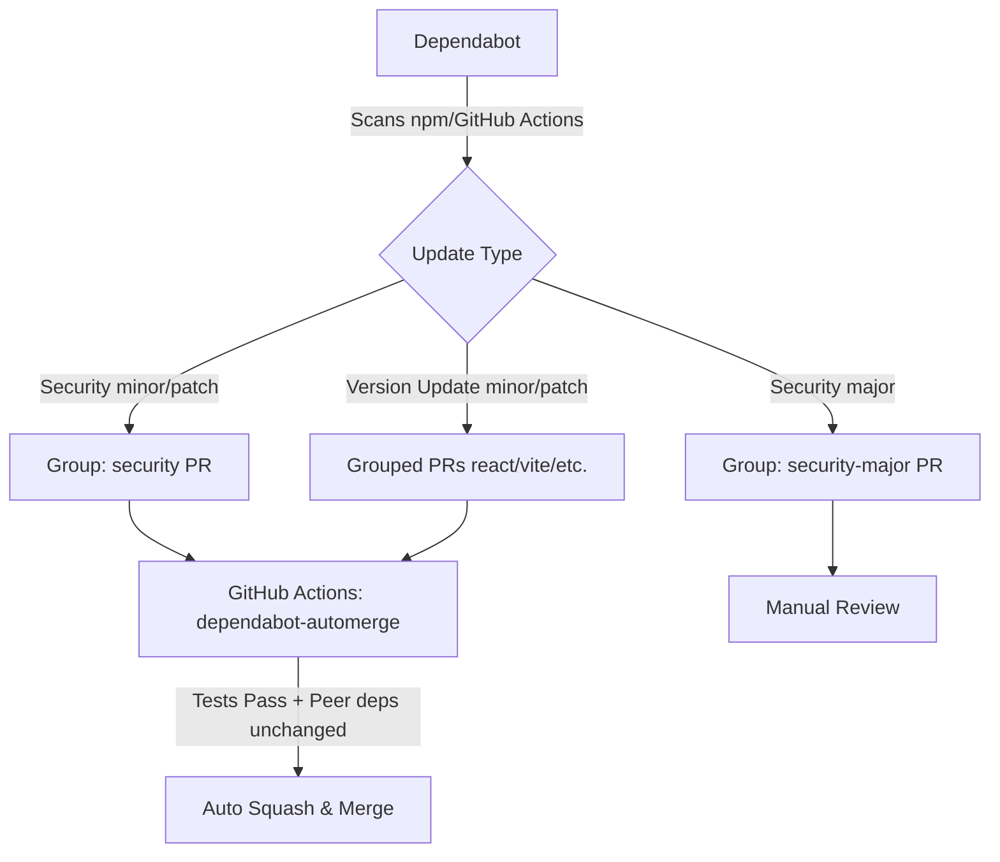

# Dependabot Security Groups & Minor Automerge Implementation Plan

> **For agentic workers:** REQUIRED SUB-SKILL: Use superpowers:subagent-driven-development to implement this plan task-by-task. Steps use checkbox (`- [ ]`) syntax for tracking.

**Goal:** Configure Dependabot to support grouped security updates, apply cooldowns, increase version ranges, and automatically merge minor/patch/security updates when CI passes.

**Architecture:** We configure Dependabot in `.github/dependabot.yml` with security groups (`security` and `security-major`), stabilization cooldowns, and `versioning-strategy: increase`. We update `.github/workflows/dependabot-automerge.yml` to automatically approve and enable squash automerge on minor, patch, and security group updates while preserving contract safety checks.

**Architecture Diagram:**


**Tech Stack:** GitHub Actions, GitHub CLI (`gh`), Dependabot YAML (v2), npm.

---

### Task 1: Enable GitHub Automated Security Fixes

**Files:**
- Repository configuration via GitHub REST API

- [ ] **Step 1: Verify current automated security fixes state**

Run:
```bash
gh api /repos/yabbadabbadev/react-boilerplate/automated-security-fixes
```
Expected: `"enabled": false`

- [ ] **Step 2: Enable automated security fixes**

Run:
```bash
gh api -X PUT /repos/yabbadabbadev/react-boilerplate/automated-security-fixes
```

- [ ] **Step 3: Verify it is now enabled**

Run:
```bash
gh api /repos/yabbadabbadev/react-boilerplate/automated-security-fixes
```
Expected: `"enabled": true`

---

### Task 2: Configure Dependabot (`.github/dependabot.yml`)

**Files:**
- Modify: `.github/dependabot.yml`

- [ ] **Step 1: Update `.github/dependabot.yml`**

Add `versioning-strategy: increase`, `cooldown`, and the `security` / `security-major` groups:

```yaml
version: 2
updates:
  - package-ecosystem: npm
    directory: '/'
    schedule:
      interval: daily
      time: '21:00'
    open-pull-requests-limit: 10
    versioning-strategy: increase
    commit-message:
      prefix: build
      include: scope
    cooldown:
      default-days: 7
      semver-major-days: 14
      semver-minor-days: 7
      semver-patch-days: 3
      exclude:
        - "@yabbadabbadev/*"
    groups:
      security:
        applies-to: security-updates
        update-types:
          - "minor"
          - "patch"
        patterns:
          - "*"
      security-major:
        applies-to: security-updates
        update-types:
          - "major"
        patterns:
          - "*"
      react:
        patterns:
          - 'react'
          - 'react-dom'
          - 'react-router'
          - '@types/react*'
      vite:
        patterns:
          - 'vite'
          - '@vitejs/*'
          - 'vite-*'
      oxlint:
        patterns:
          - 'oxlint*'
      prettier:
        patterns:
          - 'prettier'
      testing:
        patterns:
          - '@yabbadabbadev/pepito'
          - 'vitest-browser-react'
          - '@vitest/browser*'
          - 'playwright'
          - 'msw'
          - 'vitest'

  - package-ecosystem: github-actions
    directory: '/'
    schedule:
      interval: daily
      time: '21:00'
    open-pull-requests-limit: 10
    commit-message:
      prefix: build
      include: scope
    groups:
      actions:
        patterns:
          - '*'
```

- [ ] **Step 2: Validate YAML syntax**

Run:
```bash
node -e "const fs = require('fs'); require('yaml') ? console.log('YAML OK') : null" 2>/dev/null || python3 -c "import yaml; yaml.safe_load(open('.github/dependabot.yml')); print('YAML valid')"
```
Expected: `YAML valid`

- [ ] **Step 3: Commit `.github/dependabot.yml`**

```bash
git add .github/dependabot.yml
git commit -m "build(deps): configure dependabot security groups, cooldown and increase strategy"
```

---

### Task 3: Update Automerge Workflow (`.github/workflows/dependabot-automerge.yml`)

**Files:**
- Modify: `.github/workflows/dependabot-automerge.yml`

- [ ] **Step 1: Update the condition in `.github/workflows/dependabot-automerge.yml`**

Update the `Approve and enable auto-merge for patch and minor updates` step condition:

```yaml
      - name: Approve and enable auto-merge for patch and minor updates
        if: >-
          (steps.metadata.outputs.update-type == 'version-update:semver-patch' ||
           steps.metadata.outputs.update-type == 'version-update:semver-minor' ||
           steps.metadata.outputs.dependency-group == 'security') &&
          steps.peers.outputs.changed == 'false'
        run: |
          gh pr review --approve "$PR_URL"
          gh pr merge --auto --squash "$PR_URL"
        env:
          PR_URL: ${{ github.event.pull_request.html_url }}
          GH_TOKEN: ${{ secrets.GITHUB_TOKEN }}
```

- [ ] **Step 2: Validate YAML syntax**

Run:
```bash
python3 -c "import yaml; yaml.safe_load(open('.github/workflows/dependabot-automerge.yml')); print('YAML valid')"
```
Expected: `YAML valid`

- [ ] **Step 3: Commit workflow update**

```bash
git add .github/workflows/dependabot-automerge.yml
git commit -m "ci: allow automerge for dependabot security group updates"
```

---

### Task 4: Address Conflicting Pull Requests (#106, #107, #108, #109)

**Files:**
- Open GitHub Pull Requests

- [ ] **Step 1: Request rebase on PR #106**

Run:
```bash
gh pr comment 106 --body "@dependabot rebase"
```

- [ ] **Step 2: Monitor PR #106 status**

Run:
```bash
gh pr view 106 --json mergeable,state
```
Once rebased against `main`, CI checks and automerge trigger.
